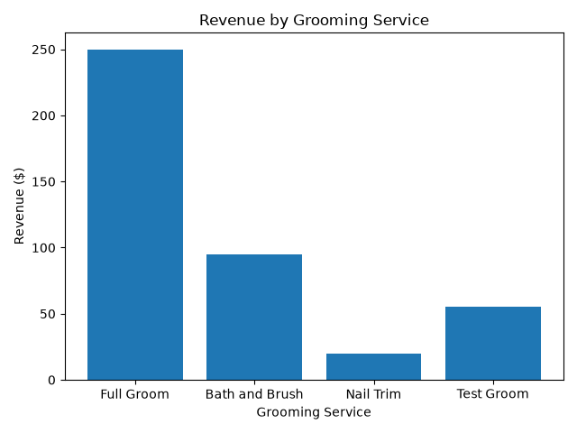
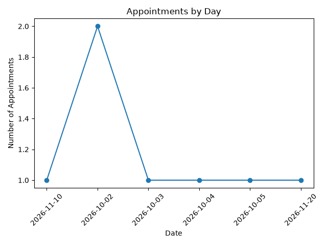

# Paws & Bubbles Pet Grooming Manager

## Business Problem
Paws & Bubbles is a small pet grooming business that needs a simple way to organize customer and pet information. The shop also needs help keep track of completed grooming services. This app helps the owner manage customers, pets, appointments, and grooming revenue.

## Business Question
Which grooming services generate the most revenue, and how many appointments should the business expect each week?

## How to Run
1. Download or clone the project from GitHub.
2. Open the project folder in VS Code.
3. Make sure all Python files and CSV files are saved in the same folder.
4. Install matplotlib by running `pip install matplotlib` in the terminal.
5. Run `main.py`.
6. Choose an option from the menu.
7. Select option 8 to save your information and exit.

## Menu Options
1. View customers and pets
2. Add or update a customer
3. Schedule an appointment
4. View appointments
5. Record a completed service
6. Sales report
7. View charts
8. Save and exit

## Charts

Full Groom generates the most revenue, followed by Bath and Brush and Nail Trim.

This chart shows how many grooming appointments were completed each day, helping the business owner understand daily appointment activity.

## Files
- `main.py` - Displays the menu and runs the program.
- `grooming.py` - Manages customer information and completed grooming transactions.
- `reports.py` - Creates the sales report and charts.
- `customers.csv` - Stores customer and pet information.
- `appointments.csv` - Stores completed grooming service transactions.
- `revenue_by_service.png` - Bar chart showing revenue by grooming service.
- `appointments_by_day.png` - Line chart showing appointments by day.
- `README.md` - Provides project information and instructions.

## Author
Megan McCluskey
